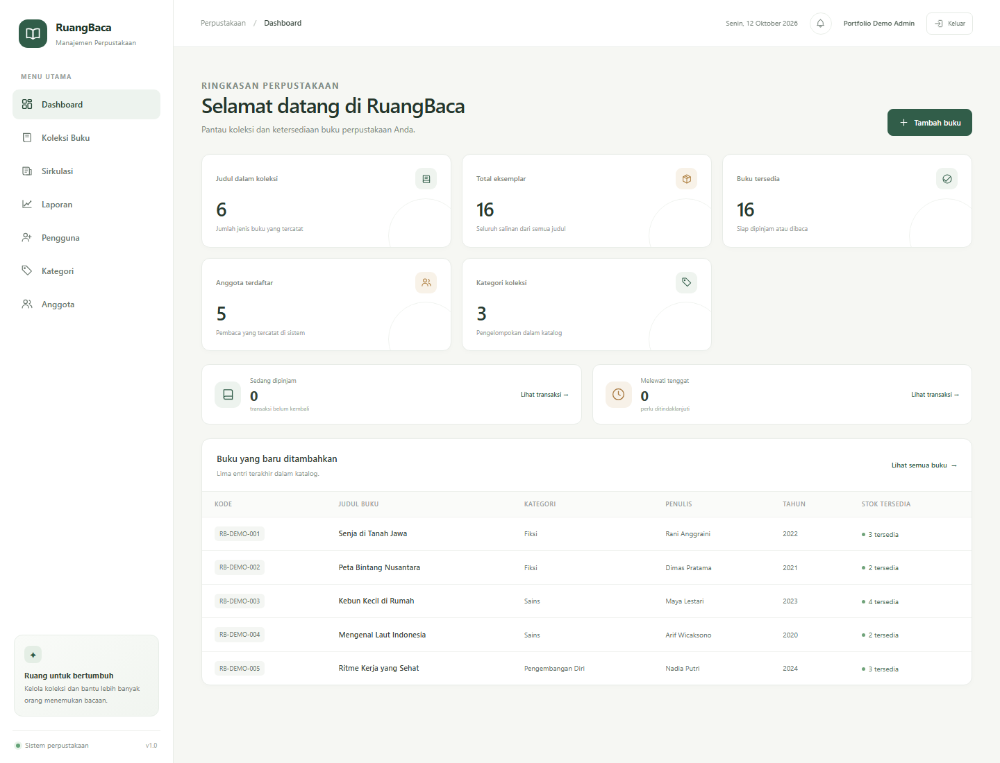

# RuangBaca

RuangBaca adalah aplikasi web untuk mengelola perpustakaan kecil. Aplikasi ini dibangun dengan Laravel 13 dan PHP 8.3, dengan antarmuka berbahasa Indonesia yang menyesuaikan layar ponsel maupun desktop.



*Dashboard dengan data demonstrasi dari basis data SQLite terpisah.*

## Fitur saat ini

- Dashboard ringkas untuk melihat kondisi koleksi.
- Katalog buku: tambah, lihat, ubah, hapus, cari, saring kategori, dan paginasi.
- Perhitungan stok tersedia yang menjaga jumlah buku yang sedang dipinjam.
- Kategori buku dan data anggota dengan pencarian serta status anggota.
- Sirkulasi buku: peminjaman satu atau beberapa judul, pengembalian, tenggat, dan pencarian/filter transaksi.
- Stok dikurangi saat dipinjam dan ditambahkan satu kali saat dikembalikan.
- Denda keterlambatan dihitung saat buku kembali, berdasarkan jumlah hari terlambat.
- Penerimaan denda dapat dicatat penuh atau sebagian, dengan riwayat pembayaran admin.
- Riwayat anggota dan transaksi dijaga agar tidak terhapus bersama data buku/anggota.
- Laporan periode: tren enam bulan, buku terpopuler, anggota aktif, dan unduhan CSV.
- Login/logout, sesi aman, pembatasan percobaan masuk, serta peran admin dan petugas.
- Halaman admin untuk mengelola akun petugas dan admin; satu-satunya admin selalu dilindungi.
- Pembuatan admin pertama melalui perintah terminal yang meminta kata sandi secara privat.
- Seeder demo yang menyiapkan kategori, buku, dan anggota tanpa membuat akun dengan kata sandi bawaan.
- Validasi formulir, pesan kesalahan berbahasa Indonesia, dan tes fitur.

## Menjalankan secara lokal

Pastikan PHP 8.3+, Composer, Node.js, dan MySQL atau SQLite tersedia.

```powershell
Copy-Item .env.example .env
composer install
php artisan key:generate
npm install
npm run build
php artisan migrate
php artisan db:seed
php artisan library:create-admin
php artisan serve
```

Buka `http://127.0.0.1:8000`, lalu masuk memakai email dan kata sandi admin yang dibuat lewat perintah `library:create-admin`. Perintah tersebut hanya membuat akun awal bila belum ada pengguna, dan meminta kata sandi dua kali tanpa menampilkannya di terminal. Setelah masuk sebagai admin, gunakan menu **Pengguna** untuk membuat akun petugas. Jika lupa kata sandi, atur ulang dari komputer lokal dengan `php artisan library:reset-password email-akun`.

Untuk MySQL, isi `DB_CONNECTION`, `DB_HOST`, `DB_PORT`, `DB_DATABASE`, `DB_USERNAME`, dan `DB_PASSWORD` di `.env` sebelum menjalankan migrasi. Pengaturan contoh memakai SQLite. Zona waktu aplikasi disetel ke `Asia/Makassar`.

Ketentuan awal dapat diubah lewat `.env`: `LIBRARY_LOAN_PERIOD_DAYS=14`, `LIBRARY_MAX_ACTIVE_LOANS=3`, dan `LIBRARY_DAILY_FINE_RUPIAH=1000`.

## Belajar dari proyek

Urutan implementasi mengikuti alur Laravel yang umum:

1. Migrasi dan model mendefinisikan bentuk serta relasi data.
2. Route menghubungkan URL dengan controller.
3. Controller memvalidasi masukan dan menjalankan aturan aplikasi.
4. Blade menyusun halaman, sedangkan CSS dan Vite mengatur tampilan.
5. Tes fitur memeriksa respons halaman, validasi, dan perubahan basis data.

Contoh alur buku: `routes/web.php` mendaftarkan resource `books`; `BookController` menangani operasi katalog; model `Book` menyimpan hubungan kategori; dan berkas Blade di `resources/views/books` menampilkan daftar, formulir, serta detail buku.

Contoh alur sirkulasi: `StoreLoanRequest` memeriksa pilihan anggota dan daftar buku; `LoanController` mengunci baris anggota serta setiap buku dalam transaksi basis data; setiap judul disimpan sebagai baris `Loan` dengan kode transaksi bersama; lalu pengembalian menghitung hari terlambat serta mengembalikan stok untuk judul itu. `FinePaymentController` mencatat pembayaran dan saldo denda tanpa mengubah riwayat pengembalian. Gate `manage-users` membatasi rute akun ke admin; formulir dan menu menyembunyikan kemampuan itu dari petugas, sedangkan server tetap memeriksa izinnya.

## Menjalankan pemeriksaan

```powershell
php artisan test --compact
vendor/bin/pint --test
npm run build
```

## Teknologi

Laravel 13 · PHP 8.3 · Blade · Tailwind CSS 4 · Vite · MySQL/SQLite
